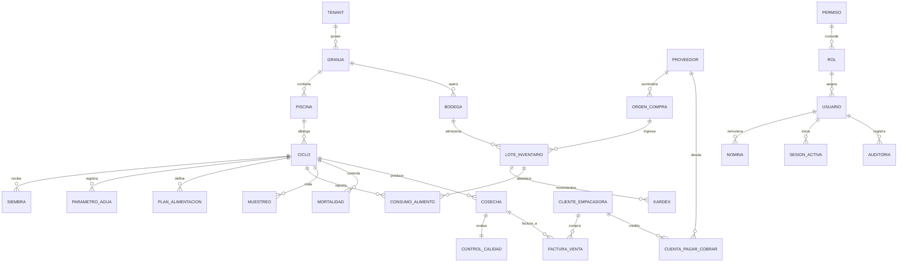

# 🦐 Diccionario y Registro de Datos: ERP Camaronera (By Fekas Corp)

> **Documento de Entrega:** Registro completo de los 5 datos insertados en las **26 colecciones** de la base de datos MongoDB Atlas (`by_fekas_corp_db`), detallando su arquitectura, relaciones de integridad referencial, encriptación AES-256-GCM y hashing Argon2id.

---

## 📌 1. Arquitectura Relacional del Sistema Acuícola

El ERP Camaronera está estructurado en 5 capas de dominio interconectadas bajo un modelo **Multitenant estricto**:



---

## 🛠️ 2. Archivo Ejecutable del Seeder

El código fuente ejecutable para poblar o reiniciar estos datos se encuentra en:
📁 **[`backend/seeds/seed_camaronera_data.js`](backend/seeds/seed_camaronera_data.js)**

Para ejecutarlo nuevamente en cualquier momento:
```bash
cd backend
npm run seed
```

---

## 📋 3. Detalle Comentado por Colección (5 Registros por Colección)

A continuación se documentan las **26 colecciones**, sus campos, tipos BSON, restricciones `$jsonSchema` y los 5 registros añadidos con sus comentarios de negocio.

---

### 1. `granjas_camaroneras`
Centros productivos acuícolas situados en las zonas estuarinas y del Golfo de Guayaquil / El Oro.

- **Campos Principales:** `_id`, `tenant_id`, `codigo` (único), `nombre`, `ubicacion`, `superficie_ha` (Decimal128), `activa` (Boolean), `responsable_id` (ObjectId).
- **Datos Añadidos:**
  1. **`GRA-SR-01` | Granja Santa Rosa**: 120.50 ha. Ubicada en El Retiro, Santa Rosa, El Oro. Responsable: Administrador.
  2. **`GRA-MA-02` | Granja Isla Mar Azul**: 85.00 ha. Ubicada en el Archipiélago de Jambelí. Responsable: Biólogo Jefe.
  3. **`GRA-ES-03` | Granja El Salitral**: 150.00 ha. Concesión en Puerto Bolívar, Machala. Responsable: Administrador.
  4. **`GRA-EH-04` | Granja Estero Hondo**: 95.25 ha. Ubicada en La Pitahaya, Arenillas. Responsable: Biólogo Jefe.
  5. **`GRA-SC-05` | Granja San Carlos**: 110.75 ha. Ubicada en Balao, Guayas. Responsable: Administrador.

---

### 2. `piscinas_estanques`
Estanques excavados en tierra con muros perimetrales, compuertas de entrada (marea/bombeo) y salida.

- **Campos Principales:** `_id`, `tenant_id`, `granja_id`, `codigo` (único por granja), `area_ha`, `profundidad_m`, `estado` (*activa | mantenimiento | inactiva*), `capacidad_m3`.
- **Datos Añadidos:**
  1. **`PSC-G1-01`**: 4.50 ha, 1.40 m profundidad, 63,000 m³ capacidad. Estado: `activa` (en Granja Santa Rosa).
  2. **`PSC-G1-02`**: 5.20 ha, 1.50 m profundidad, 78,000 m³ capacidad. Estado: `activa` (en Granja Santa Rosa).
  3. **`PSC-G2-01`**: 6.00 ha, 1.45 m profundidad, 87,000 m³ capacidad. Estado: `activa` (en Granja Mar Azul).
  4. **`PSC-G3-01`**: 4.80 ha, 1.35 m profundidad, 64,800 m³ capacidad. Estado: `mantenimiento` (secado y encalado en El Salitral).
  5. **`PSC-G4-01`**: 5.50 ha, 1.50 m profundidad, 82,500 m³ capacidad. Estado: `inactiva` (preparada para siembra en Estero Hondo).

---

### 3. `ciclos_cultivo`
Período biológico y productivo que transcurre desde la siembra de la post-larva hasta la pesca o cosecha comercial.

- **Campos Principales:** `_id`, `tenant_id`, `granja_id`, `piscina_id`, `codigo` (único por piscina), `fecha_inicio`, `fecha_fin`, `estado` (*planificado | activo | cerrado*), `biomasa_estimada_kg`, `especie`.
- **Datos Añadidos:**
  1. **`CIC-2026-P01`**: Piscina P-01 (Santa Rosa). Inicio: 01/08/2026. Estado: `activo`. Biomasa: 6,800 kg. Especie: *Litopenaeus vannamei*.
  2. **`CIC-2026-P02`**: Piscina P-02 (Santa Rosa). Inicio: 15/08/2026. Estado: `activo`. Biomasa: 7,950 kg. Especie: *Litopenaeus vannamei*.
  3. **`CIC-2026-P03`**: Piscina P-03 (Mar Azul). Inicio: 10/07/2026, Fin: 20/10/2026. Estado: `cerrado` (cosechado). Biomasa final: 9,400 kg.
  4. **`CIC-2026-P04`**: Piscina P-04 (El Salitral). Inicio: 01/06/2026, Fin: 25/09/2026. Estado: `cerrado`. Biomasa: 8,100 kg.
  5. **`CIC-2026-P05`**: Piscina P-05 (Estero Hondo). Inicio: 05/11/2026. Estado: `planificado`. Biomasa inicial: 0 kg.

---

### 4. `proveedores`
Empresas que abastecen post-larvas de laboratorio, balanceados e insumos para tratamiento de agua.

- **Seguridad:** Cifrado simétrico autenticado **AES-256-GCM** para RUC y números de cuenta bancaria (`_cifrado`, `_iv`, `_tag`).
- **Datos Añadidos:**
  1. **`PRV-LARV-01` | Laboratorio de Larvas del Pacífico S.A. (Larvimar)**: RUC y Cta. cifrados. Proveedor de post-larvas PL-12.
  2. **`PRV-BAL-02` | Balcamaron Alimentos Balanceados Cía. Ltda.**: RUC y Cta. cifrados. Alimentos 35% y 28% proteína.
  3. **`PRV-QUIM-03` | AquaTech Soluciones Químicas & Equipos Acuícolas**: RUC y Cta. cifrados. Reactivos y fertilizantes.
  4. **`PRV-PROB-04` | Probióticos Marinos BioAqua Ecuador S.A.**: RUC y Cta. cifrados. Bacterias biorremediadoras.
  5. **`PRV-MIN-05` | Distribuidora de Minerales & Cal Agrícola El Oro**: RUC y Cta. cifrados. Carbonato de calcio para pH.

---

### 5. `siembras_larvas`
Registro de la siembra inicial de post-larvas en cada estanque de cultivo.

- **Campos Principales:** `_id`, `tenant_id`, `granja_id`, `ciclo_id`, `proveedor_id`, `fecha`, `cantidad` (Int32), `densidad_m2` (Decimal128), `lote_larvas`, `supervivencia_estimada_pct`.
- **Datos Añadidos:**
  1. **Siembra C1**: 450,000 post-larvas PL-12 en 4.5 ha. Densidad: 10 camarones/m². Lote `LOT-PL12-LARV-2026-081`. Supervivencia: 75.5%.
  2. **Siembra C2**: 520,000 post-larvas PL-12 en 5.2 ha. Densidad: 10 camarones/m². Lote `LOT-PL12-LARV-2026-088`. Supervivencia: 78.0%.
  3. **Siembra C3**: 600,000 post-larvas PL-12 en 6.0 ha. Densidad: 10 camarones/m². Lote `LOT-PL12-LARV-2026-072`. Supervivencia: 80.0%.
  4. **Siembra C4**: 480,000 post-larvas PL-12 en 4.8 ha. Densidad: 10 camarones/m². Lote `LOT-PL12-LARV-2026-061`. Supervivencia: 72.0%.
  5. **Siembra C5**: 550,000 post-larvas planificadas para piscina 5. Densidad: 10 camarones/m². Lote `LOT-PL12-LARV-2026-115`.

---

### 6. `insumos_productos`
Catálogo de balanceados, probióticos, fertilizantes y correctores químicos.

- **Campos Principales:** `_id`, `tenant_id`, `sku` (único), `nombre`, `categoria` (*balanceado | probiotico | quimico | fertilizante | otro*), `unidad` (*kg | l | unidad*), `stock_minimo`, `activo`.
- **Datos Añadidos:**
  1. **`BAL-INIC-35P`**: Balanceado Extruido Iniciador 35% Proteína (Pellet 1.2 mm). Unidad: kg. Stock mín: 1,000 kg.
  2. **`BAL-ENG-28P`**: Balanceado de Engorde Comercial 28% Proteína (Pellet 2.0 mm). Unidad: kg. Stock mín: 2,500 kg.
  3. **`BIO-AQUABAC-01`**: Probiótico Líquido AquaBac Pro (Biorremediador de fondo). Unidad: litros. Stock mín: 100 l.
  4. **`QUIM-CAL-CARB`**: Carbonato de Calcio Agrícola Micronizado para Regulación de pH. Unidad: kg. Stock mín: 2,000 kg.
  5. **`FERT-NITR-SOD`**: Nitrato de Sodio Técnico para Fertilización y Bloom de Algas. Unidad: kg. Stock mín: 500 kg.

---

### 7. `bodegas`
Almacenes físicos por granja para resguardo de balanceado y productos biológicos.

- **Campos Principales:** `_id`, `tenant_id`, `granja_id`, `codigo` (único por granja), `nombre`, `ubicacion`, `responsable_id`, `activa`.
- **Datos Añadidos:**
  1. **`BOD-SR-ALIM`**: Bodega Principal de Alimentos Santa Rosa. Ubicación: Campamento Central. Resp: Jefe de Bodega.
  2. **`BOD-SR-QUIM`**: Bodega de Químicos & Probióticos Santa Rosa. Ubicación: Muelle 1. Resp: Jefe de Bodega.
  3. **`BOD-MA-ISLA`**: Bodega Insular Mar Azul. Ubicación: Isla Jambelí. Resp: Operador de Campo.
  4. **`BOD-ES-CENT`**: Bodega El Salitral. Ubicación: Puerto Bolívar. Resp: Administrador.
  5. **`BOD-EH-CAMP`**: Bodega Estero Hondo. Ubicación: Arenillas Km 12. Resp: Operador de Campo.

---

### 8. `ordenes_compra`
Gestión de compras a proveedores con detalle de líneas de producto, precios unitarios y estados de aprobación.

- **Campos Principales:** `_id`, `tenant_id`, `granja_id`, `proveedor_id`, `bodega_id`, `numero` (único), `fecha`, `estado` (*borrador | aprobada | recibida | cancelada*), `total`, `creado_por`, `aprobado_por`, `lineas`.
- **Datos Añadidos:**
  1. **`OC-2026-0001`**: Balcamaron. 2,500 kg de Balanceado Iniciador a $1.30/kg. Total: $3,250.00. Estado: `recibida`.
  2. **`OC-2026-0002`**: Balcamaron. 3,500 kg de Balanceado Engorde a $1.20/kg. Total: $4,200.00. Estado: `recibida`.
  3. **`OC-2026-0003`**: BioAqua Ecuador. 50 litros de Probiótico AquaBac a $35.00/l. Total: $1,750.00. Estado: `aprobada`.
  4. **`OC-2026-0004`**: Cal El Oro. 3,000 kg de Carbonato de Calcio a $0.30/kg. Total: $900.00. Estado: `borrador`.
  5. **`OC-2026-0005`**: AquaTech. 1,000 kg Nitrato de Sodio a $1.20/kg. Total: $1,200.00. Estado: `cancelada`.

---

### 9. `lotes_inventario`
Gestión de existencias por lote específico de producción con fecha de vencimiento y costos unitarios.

- **Campos Principales:** `_id`, `tenant_id`, `granja_id`, `bodega_id`, `producto_id`, `proveedor_id`, `codigo_lote` (único), `fecha_ingreso`, `vence_at`, `cantidad_inicial`, `cantidad_actual`, `costo_unitario`.
- **Datos Añadidos:**
  1. **`LOT-BAL-35P-2026-01`**: Balanceado 35%. Inicial: 2,500 kg | Actual: 1,850 kg. Costo: $1.30/kg. Vence: 25/01/2027.
  2. **`LOT-BAL-28P-2026-02`**: Balanceado 28%. Inicial: 3,500 kg | Actual: 2,900 kg. Costo: $1.20/kg. Vence: 12/02/2027.
  3. **`LOT-BIO-AQUA-2026-03`**: Probiótico AquaBac. Inicial: 50 l | Actual: 42 l. Costo: $35.00/l. Vence: 20/08/2027.
  4. **`LOT-CAL-AGR-2026-04`**: Carbonato de Calcio. Inicial: 3,000 kg | Actual: 2,500 kg. Costo: $0.30/kg. Vence: 05/09/2028.
  5. **`LOT-FERT-NIT-2026-05`**: Nitrato de Sodio. Inicial: 1,000 kg | Actual: 900 kg. Costo: $1.20/kg. Vence: 20/09/2027.

---

### 10. `movimientos_kardex`
Bitácora transaccional e inmutable de entradas, salidas y ajustes de inventario con saldo posterior calculado.

- **Campos Principales:** `_id`, `tenant_id`, `granja_id`, `bodega_id`, `lote_id`, `usuario_id`, `fecha`, `tipo` (*entrada | salida | ajuste*), `cantidad`, `saldo_posterior`, `referencia` (único), `motivo`.
- **Datos Añadidos:**
  1. **`KDX-ING-001`**: Entrada de 2,500 kg Lote 1 por OC-2026-0001. Saldo: 2,500 kg.
  2. **`KDX-SAL-001`**: Salida de 650 kg Lote 1 para alimentación en Piscina P-01. Saldo: 1,850 kg.
  3. **`KDX-ING-002`**: Entrada de 3,500 kg Lote 2 por OC-2026-0002. Saldo: 3,500 kg.
  4. **`KDX-SAL-002`**: Salida de 600 kg Lote 2 para alimentación en Piscina P-02. Saldo: 2,900 kg.
  5. **`KDX-AJU-001`**: Ajuste de 8 l Lote 3 por dosificación de emergencia en Piscina P-03. Saldo: 42 l.

---

### 11. `planes_alimentacion`
Estrategia nutricional establecida por el Biólogo según el peso corporal y la curva de crecimiento del camarón.

- **Campos Principales:** `_id`, `tenant_id`, `granja_id`, `ciclo_id`, `producto_id`, `fecha_inicio`, `fecha_fin`, `racion_diaria_kg`, `frecuencia_diaria` (Int32), `aprobado_por`, `estado` (*borrador | aprobado | cerrado*).
- **Datos Añadidos:**
  1. **Plan C1 Inicial**: 45.00 kg/día, 4 tomas diarias con balanceado 35%. Estado: `cerrado`.
  2. **Plan C1 Engorde**: 85.00 kg/día, 3 tomas diarias con balanceado 28%. Estado: `aprobado`.
  3. **Plan C2 Engorde**: 95.00 kg/día, 3 tomas diarias con balanceado 28%. Estado: `aprobado`.
  4. **Plan C3 Cierre**: 110.00 kg/día, 4 tomas diarias previo a cosecha. Estado: `cerrado`.
  5. **Plan C5 Preliminar**: 50.00 kg/día proyectados para siembra nueva. Estado: `borrador`.

---

### 12. `consumo_alimento_diario`
Ejecución en campo de la alimentación diaria, controlando el Factor de Conversión Alimenticia (FCA) y biomasa.

- **Campos Principales:** `_id`, `tenant_id`, `granja_id`, `piscina_id`, `ciclo_id`, `plan_id`, `lote_id`, `usuario_id`, `fecha`, `cantidad_kg`, `fca`, `biomasa_kg`, `observacion`.
- **Datos Añadidos:**
  1. **Consumo P-01 (24/10)**: 85.50 kg aplicados. FCA: 1.25. Biomasa: 6,750 kg. Observación: Consumo 100% en bandejas.
  2. **Consumo P-01 (25/10)**: 86.00 kg aplicados. FCA: 1.26. Biomasa: 6,800 kg. Observación: Tracto digestivo lleno.
  3. **Consumo P-02 (25/10)**: 94.50 kg aplicados. FCA: 1.28. Biomasa: 7,900 kg. Observación: Alimentación matutina y vespertina.
  4. **Consumo P-02 (26/10)**: 95.00 kg aplicados. FCA: 1.28. Biomasa: 7,950 kg. Observación: Distribución con tolva mecánica.
  5. **Consumo P-03 (18/10)**: 108.00 kg aplicados. FCA: 1.32. Biomasa: 9,350 kg. Observación: Última ración antes de cosecha.

---

### 13. `parametros_agua`
Mediciones multiparamétricas diarias de calidad del agua para garantizar la supervivencia del camarón.

- **Campos Principales:** `_id`, `tenant_id`, `granja_id`, `piscina_id`, `ciclo_id`, `usuario_id`, `fecha`, `oxigeno_mg_l`, `salinidad_ppt`, `ph`, `temperatura_c`, `amonio_mg_l`, `alerta` (Boolean).
- **Datos Añadidos:**
  1. **P-01 (26/10)**: O₂: 5.80 mg/l | Salinidad: 22.50 ppt | pH: 7.85 | Temp: 28.50 °C | Amonio: 0.05 mg/l. Alerta: `false`.
  2. **P-01 (27/10)**: O₂: 5.60 mg/l | Salinidad: 23.00 ppt | pH: 7.90 | Temp: 28.80 °C | Amonio: 0.06 mg/l. Alerta: `false`.
  3. **P-02 (27/10)**: O₂: 4.10 mg/l | Salinidad: 21.00 ppt | pH: 7.60 | Temp: 29.20 °C | Amonio: 0.18 mg/l. Alerta: `true` (requirió activación de 4 aireadores).
  4. **P-03 (19/10)**: O₂: 6.10 mg/l | Salinidad: 25.00 ppt | pH: 8.10 | Temp: 27.90 °C | Amonio: 0.02 mg/l. Alerta: `false`.
  5. **P-04 (24/09)**: O₂: 5.40 mg/l | Salinidad: 24.50 ppt | pH: 7.75 | Temp: 28.10 °C | Amonio: 0.04 mg/l. Alerta: `false`.

---

### 14. `muestreos_biometricos`
Monitoreo semanal del peso medio, talla corporal y cálculo de biomasa para determinar fecha óptima de cosecha.

- **Campos Principales:** `_id`, `tenant_id`, `granja_id`, `piscina_id`, `ciclo_id`, `usuario_id`, `fecha`, `peso_promedio_g`, `talla_promedio_cm`, `muestra_individuos` (Int32), `biomasa_estimada_kg`, `observacion`.
- **Datos Añadidos:**
  1. **P-01 (Día 45)**: Peso: 8.50 g | Talla: 9.20 cm | Muestra: 150 camarones | Biomasa est.: 3,200 kg.
  2. **P-01 (Día 75)**: Peso: 15.80 g | Talla: 13.10 cm | Muestra: 180 camarones | Biomasa est.: 5,800 kg.
  3. **P-01 (Pre-cosecha)**: Peso: 18.20 g | Talla: 14.30 cm | Muestra: 200 camarones | Biomasa est.: 6,800 kg (Talla comercial 50/60).
  4. **P-02 (Día 66)**: Peso: 16.50 g | Talla: 13.50 cm | Muestra: 175 camarones | Biomasa est.: 7,950 kg.
  5. **P-03 (Final C3)**: Peso: 22.40 g | Talla: 15.80 cm | Muestra: 220 camarones | Biomasa est.: 9,400 kg (Talla premium 40/50).

---

### 15. `registro_mortalidad`
Control sanitario y registro de bajas detectadas en orillas o mallas de desagüe.

- **Campos Principales:** `_id`, `tenant_id`, `granja_id`, `piscina_id`, `ciclo_id`, `usuario_id`, `fecha`, `cantidad` (Int32), `causa`, `observacion`.
- **Datos Añadidos:**
  1. **P-01 (05/08)**: 350 individuos. Causa: Estrés de transporte post-siembra.
  2. **P-01 (02/09)**: 120 individuos. Causa: Muda masiva post-luna llena con ligero canibalismo.
  3. **P-02 (20/09)**: 210 individuos. Causa: Descenso de oxígeno en madrugada nublada.
  4. **P-03 (15/08)**: 95 individuos. Causa: Depredación por aves marinas en bajamar.
  5. **P-04 (28/07)**: 180 individuos. Causa: Estrés osmótico por lluvia torrencial.

---

### 16. `cosechas_pesca`
Registro de la pesca comercial en estanque con pesaje oficial, hielo líquido y bines térmicos.

- **Campos Principales:** `_id`, `tenant_id`, `granja_id`, `piscina_id`, `ciclo_id`, `fecha`, `peso_bruto_kg`, `peso_neto_kg`, `cantidad_estimada` (Int32), `responsable_id`, `estado` (*programada | ejecutada | anulada*).
- **Datos Añadidos:**
  1. **`COS-001` (C3)**: 20/10/2026. Bruto: 9,650 kg | Neto: 9,400 kg | Estimado: 420,000 camarones. Estado: `ejecutada`.
  2. **`COS-002` (C4)**: 25/09/2026. Bruto: 8,350 kg | Neto: 8,100 kg | Estimado: 390,000 camarones. Estado: `ejecutada`.
  3. **`COS-003` (C1)**: 10/11/2026. Bruto: 7,050 kg | Neto: 6,850 kg | Estimado: 375,000 camarones. Estado: `programada`.
  4. **`COS-004` (C2)**: 20/11/2026. Bruto: 8,200 kg | Neto: 8,000 kg | Estimado: 410,000 camarones. Estado: `programada`.
  5. **`COS-005` (C5)**: 15/12/2026. Bruto: 0 kg | Neto: 0 kg. Estado: `anulada`.

---

### 17. `control_calidad_cosecha`
Evaluación de laboratorio sobre el camarón recién cosechado: textura, olor, color y niveles de metabisulfito.

- **Campos Principales:** `_id`, `tenant_id`, `granja_id`, `cosecha_id` (único), `analista_id`, `fecha`, `gramaje_g`, `metabisulfito_ppm`, `textura` (*firme | media | blanda*), `aprobado` (Boolean), `observacion`.
- **Datos Añadidos:**
  1. **Calidad COS-001**: Gramaje: 22.38 g | Metabisulfito: 45.50 ppm | Textura: `firme` | Aprobado: `true` (Apto exportación UE).
  2. **Calidad COS-002**: Gramaje: 20.76 g | Metabisulfito: 52.00 ppm | Textura: `firme` | Aprobado: `true` (Grado A sin melanosis).
  3. **Calidad COS-003**: Gramaje: 18.25 g | Metabisulfito: 40.00 ppm | Textura: `firme` | Aprobado: `true`.
  4. **Calidad COS-004**: Gramaje: 19.50 g | Metabisulfito: 48.00 ppm | Textura: `media` | Aprobado: `true`.
  5. **Calidad COS-005**: Gramaje: 12.00 g | Metabisulfito: 115.00 ppm | Textura: `blanda` | Aprobado: `false` (Rechazado por exceso de químico).

---

### 18. `clientes_empacadoras`
Empresas exportadoras y plantas procesadoras receptoras del camarón ecuatoriano.

- **Seguridad:** Cifrado simétrico autenticado **AES-256-GCM** para RUC (`ruc_cifrado`, `ruc_iv`, `ruc_tag`).
- **Datos Añadidos:**
  1. **`CLI-EMP-01` | Industrial Pesquera Santa Priscila S.A.**: RUC cifrado. Contacto: Ing. Xavier Durán.
  2. **`CLI-EMP-02` | Omarsa Operadora y Empacadora del Mar S.A.**: RUC cifrado. Contacto: Lcda. Patricia Noboa.
  3. **`CLI-EMP-03` | Sociedad Nacional de Galápagos SONGA C.A.**: RUC cifrado. Contacto: Ing. Fernando Arosemena.
  4. **`CLI-EMP-04` | Promarisco S.A. - Grupo Nueva Pescanova**: RUC cifrado. Contacto: Dr. Gabriel Icaza.
  5. **`CLI-EMP-05` | Exportadora de Alimentos EXPALSA C.A.**: RUC cifrado. Contacto: Ing. Daniela Baquerizo.

---

### 19. `facturas_venta`
Facturas por liquidación de pesca entregada en planta de empaque (Tarifa 0% IVA para exportación de productos del mar).

- **Campos Principales:** `_id`, `tenant_id`, `granja_id`, `cliente_id`, `cosecha_id`, `numero` (único), `fecha`, `vence_at`, `subtotal`, `impuestos`, `total`, `estado` (*emitida | pagada | anulada*), `creado_por`.
- **Datos Añadidos:**
  1. **`FAC-001-001-00000451`**: Santa Priscila por COS-001 (9,400 kg * $3.80/kg). Total: **$35,720.00**. Estado: `pagada`.
  2. **`FAC-001-001-00000452`**: Omarsa por COS-002 (8,100 kg * $3.70/kg). Total: **$29,970.00**. Estado: `pagada`.
  3. **`FAC-001-001-00000453`**: Songa por COS-003 (6,850 kg * $3.60/kg). Total: **$24,660.00**. Estado: `emitida`.
  4. **`FAC-001-001-00000454`**: Promarisco por COS-004 (8,000 kg * $3.60/kg). Total: **$28,800.00**. Estado: `emitida`.
  5. **`FAC-001-001-00000455`**: Expalsa por COS-005 anulada. Total: **$0.00**. Estado: `anulada`.

---

### 20. `cuentas_por_pagar_cobrar`
Control financiero de compromisos adquiridos con proveedores de balanceado y cuentas por cobrar a empacadoras.

- **Campos Principales:** `_id`, `tenant_id`, `granja_id`, `tipo` (*pagar | cobrar*), `proveedor_id`/`cliente_id`, `orden_compra_id`/`factura_id`, `fecha_emision`, `vence_at`, `monto_original`, `saldo_pendiente`, `estado` (*pendiente | parcial | pagada | vencida*).
- **Datos Añadidos:**
  1. **CXP Balcamaron (OC-01)**: Tipo: `pagar`. Monto: $3,250.00 | Saldo: $0.00. Estado: `pagada`.
  2. **CXP Balcamaron (OC-02)**: Tipo: `pagar`. Monto: $4,200.00 | Saldo: $1,500.00. Estado: `parcial`.
  3. **CXP BioAqua (OC-03)**: Tipo: `pagar`. Monto: $1,750.00 | Saldo: $1,750.00. Estado: `pendiente`.
  4. **CXC Santa Priscila (FAC-01)**: Tipo: `cobrar`. Monto: $35,720.00 | Saldo: $0.00. Estado: `pagada`.
  5. **CXC Songa (FAC-03)**: Tipo: `cobrar`. Monto: $24,660.00 | Saldo: $24,660.00. Estado: `pendiente`.

---

### 21. `nomina_empleados_campo`
Roles de pago del personal técnico y operativo de campo, considerando aportes IESS (9.45% aporte personal) y cuentas bancarias cifradas.

- **Campos Principales:** `_id`, `tenant_id`, `granja_id`, `usuario_id`, `periodo_inicio`, `periodo_fin`, `dias_trabajados` (Int32), `sueldo_bruto`, `deducciones`, `sueldo_neto`, `cuenta_cifrada`, `estado` (*borrador | aprobada | pagada*).
- **Datos Añadidos:**
  1. **Nómina Biólogo Jefe**: Bruto: $1,450.00 | IESS: $137.03 | Neto: **$1,312.97**. Estado: `pagada`.
  2. **Nómina Operador de Estanques**: Bruto: $650.00 | IESS: $61.43 | Neto: **$588.57**. Estado: `pagada`.
  3. **Nómina Jefe de Bodega**: Bruto: $900.00 | IESS: $85.05 | Neto: **$814.95**. Estado: `aprobada`.
  4. **Nómina Analista de Calidad**: Bruto: $1,100.00 | IESS: $103.95 | Neto: **$996.05**. Estado: `aprobada`.
  5. **Nómina Contadora General**: Bruto: $1,350.00 | IESS: $127.58 | Neto: **$1,222.42**. Estado: `borrador`.

---

### 22. `permisos`
Permisos RBAC granulares con código único, recurso objetivo y acción permitida.

- **Campos Principales:** `_id`, `tenant_id`, `codigo` (único), `recurso`, `accion` (*leer | crear | editar | eliminar | aprobar*), `descripcion`.
- **Datos Añadidos:**
  1. **`granjas:leer`**: Visualización y monitoreo cartográfico de granjas camaroneras.
  2. **`cosechas:crear`**: Programación y apertura de turnos de pesca y cosecha.
  3. **`cosechas:aprobar`**: Validación técnica final y cierre contable de cosechas.
  4. **`calidad:crear`**: Ingreso de pruebas organolépticas y de metabisulfito.
  5. **`nomina:aprobar`**: Autorización y desembolso de roles de pago de trabajadores.

---

### 23. `roles`
Perfiles ocupacionales configurados bajo el principio de mínimo privilegio.

- **Campos Principales:** `_id`, `tenant_id`, `codigo` (único), `nombre`, `permiso_ids` (Array de ObjectId), `activo`.
- **Datos Añadidos:**
  1. **`biologo_campo`**: Biólogo y Especialista en Sanidad Acuícola.
  2. **`operador_estanques`**: Operador de Estanques y Alimentación.
  3. **`jefe_bodega`**: Jefe de Bodega, Insumos y Logística.
  4. **`analista_calidad`**: Analista de Control de Calidad e Inocuidad.
  5. **`contador_general`**: Contador General y Finanzas Acuícolas.

---

### 24. `usuarios`
Personal autenticado en el sistema. Contraseñas protegidas mediante **Argon2id** (memoria 64 MB, 3 iteraciones, paralelismo 1) y cédulas cifradas con **AES-256-GCM**.

- **Campos Principales:** `_id`, `tenant_id`, `email` (único), `password_hash`, `nombre`, `activo`, `rol_ids`, `granja_ids`, `piscina_ids`, `cedula_cifrada`.
- **Datos Añadidos:**
  1. **`biologo.campo@fekascorp.com`**: MSc. Javier Andrade (Biólogo Jefe). Asignado a Granjas G1, G2, G3.
  2. **`operador.piscina@fekascorp.com`**: Manuel Chimbo (Técnico Operador de Estanques). Asignado a Granjas G1, G2.
  3. **`bodega.insumos@fekascorp.com`**: Gonzalo Loor (Jefe de Bodega y Logística). Asignado a Granjas G1, G2, G3, G4.
  4. **`calidad.cosecha@fekascorp.com`**: Ing. Mariela Cedeño (Analista de Calidad). Alcance: todas las granjas.
  5. **`contabilidad@fekascorp.com`**: CPA. Lorena Zambrano (Contadora General). Alcance: todas las granjas.

---

### 25. `sesiones_activas`
Control de tokens de acceso JWT y refresh tokens rotativos para auditoría y revocación de accesos.

- **Campos Principales:** `_id`, `tenant_id`, `usuario_id`, `jti_hash` (SHA-256 único), `refresh_hash` (SHA-256), `expires_at`, `revocada` (Boolean), `ip_hash`, `user_agent`, `rotada_en`.
- **Datos Añadidos:**
  1. **Sesión Biólogo Jefe**: Chrome en Windows 10, IP hasheada, expiración en 7 días, revocada: `false`.
  2. **Sesión Operador de Campo**: Móvil Samsung Galaxy Android 14, IP hasheada, expiración en 7 días, revocada: `false`.
  3. **Sesión Jefe de Bodega**: Firefox en Windows 10, IP hasheada, expiración en 7 días, revocada: `false`.
  4. **Sesión Analista de Calidad**: Safari en macOS Sonoma, IP hasheada, expiración en 7 días, revocada: `false`.
  5. **Sesión Contadora General**: Edge en Windows 10, IP hasheada, expiración en 7 días, revocada: `false`.

---

### 26. `logs_auditoria`
Trazabilidad inmutable de eventos sensibles del sistema con fecha ISO y hash de IP de origen.

- **Campos Principales:** `_id`, `tenant_id`, `usuario_id`, `accion`, `recurso`, `recurso_id`, `fecha`, `ip_hash`, `resultado` (*exito | denegado | error*), `detalle`.
- **Datos Añadidos:**
  1. **`REGISTRO_PARAMETROS_AGUA`**: Biólogo registró calidad matutina en Piscina P-01 (Oxígeno: 5.8 mg/l). Resultado: `exito`.
  2. **`REGISTRO_CONSUMO_ALIMENTO`**: Operador registró aplicación de 95 kg balanceado en Piscina P-02. Resultado: `exito`.
  3. **`RECEPCION_INVENTARIO_KARDEX`**: Bodeguero registró ingreso de lote LOT-BAL-28P-2026-02. Resultado: `exito`.
  4. **`EVALUACION_CALIDAD_COSECHA`**: Analista de calidad aprobó Cosecha COS-001 (45.5 ppm metabisulfito). Resultado: `exito`.
  5. **`EMISION_FACTURA_VENTA`**: Contadora emitió factura electrónica a Industrial Pesquera Santa Priscila S.A. Resultado: `exito`.

---

## 📊 4. Conteo de Verificación Final en Base de Datos

| N° | Nombre de la Colección | Registros Previos | Registros Nuevos | Total Actual |
|:---|:---|:---:|:---:|:---:|
| 1 | `granjas_camaroneras` | 0 | **+5** | **5** |
| 2 | `piscinas_estanques` | 0 | **+5** | **5** |
| 3 | `ciclos_cultivo` | 0 | **+5** | **5** |
| 4 | `proveedores` | 0 | **+5** | **5** |
| 5 | `siembras_larvas` | 0 | **+5** | **5** |
| 6 | `insumos_productos` | 0 | **+5** | **5** |
| 7 | `bodegas` | 0 | **+5** | **5** |
| 8 | `ordenes_compra` | 0 | **+5** | **5** |
| 9 | `lotes_inventario` | 0 | **+5** | **5** |
| 10 | `movimientos_kardex` | 0 | **+5** | **5** |
| 11 | `planes_alimentacion` | 0 | **+5** | **5** |
| 12 | `consumo_alimento_diario` | 0 | **+5** | **5** |
| 13 | `parametros_agua` | 0 | **+5** | **5** |
| 14 | `muestreos_biometricos` | 0 | **+5** | **5** |
| 15 | `registro_mortalidad` | 0 | **+5** | **5** |
| 16 | `cosechas_pesca` | 0 | **+5** | **5** |
| 17 | `control_calidad_cosecha` | 0 | **+5** | **5** |
| 18 | `clientes_empacadoras` | 0 | **+5** | **5** |
| 19 | `facturas_venta` | 0 | **+5** | **5** |
| 20 | `cuentas_por_pagar_cobrar` | 0 | **+5** | **5** |
| 21 | `nomina_empleados_campo` | 0 | **+5** | **5** |
| 22 | `permisos` | 9 | **+5** | **14** |
| 23 | `roles` | 1 | **+5** | **6** |
| 24 | `usuarios` | 1 | **+5** | **6** |
| 25 | `sesiones_activas` | 2 | **+5** | **7** |
| 26 | `logs_auditoria` | 0 | **+5** | **5** |

*(Total colecciones verificadas en MongoDB Atlas: **26 de 26**)*
