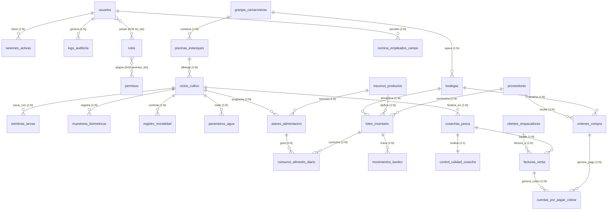
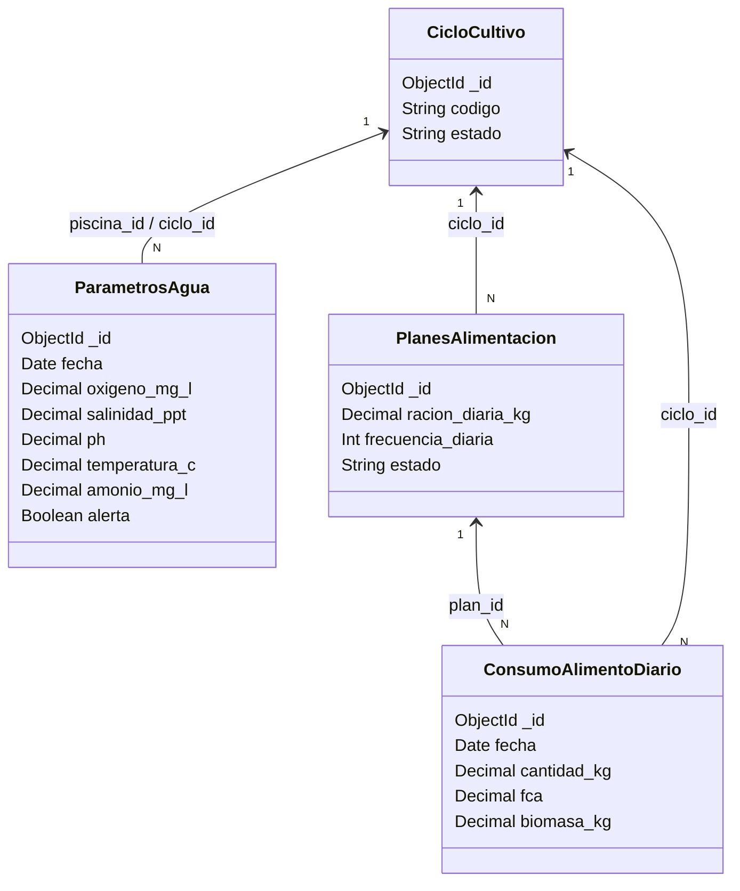

# 🦐 Modelado de Datos y Relaciones — ERP Camaronera By Fekas Corp

Este documento detalla la arquitectura de datos, diccionario de entidades, diagramas entidad-relación (ER) y restricciones `$jsonSchema` implementadas en la base de datos **`by_fekas_corp_db`**.

---

## 1. Principios de Arquitectura del Modelo

1. **Aislamiento Multitenant Estricto:**
   * Todas las 26 colecciones contienen de forma obligatoria los campos base:
     * `_id` (`ObjectId`): Identificador único del documento.
     * `tenant_id` (`ObjectId`): Identificador de la organización o empresa agrícola.
     * `created_at` (`Date`) y `updated_at` (`Date`): Trazabilidad temporal.
   * La mayoría de índices compuestos inician con `{ tenant_id: 1, ... }` para garantizar aislamiento físico de consultas y alto rendimiento.
2. **Integridad Referencial por Aplicación:**
   * MongoDB no impone claves foráneas automáticas en cascada. Las relaciones se mantienen mediante **referencias manuales por `ObjectId`**, validadas en esquemas BSON (`bsonType: 'objectId'`) y controladas en la capa de negocio.
3. **Ausencia de Herencia de Clases (Composición vs Herencia):**
   * No existe herencia `extends` entre entidades (ej. `Piscina` no hereda de `Granja`). Se modelan como **asociaciones directas** y composición modular.
4. **Cifrado de Campos Sensibles en Reposo:**
   * Cédulas, RUCs y cuentas bancarias no se almacenan en texto plano; se descomponen en tres campos BSON `binData`: `*_cifrada`, `*_iv` y `*_tag` (cifrado simétrico AES-256-GCM).
5. **Tipos de Datos de Precisión:**
   * Los valores monetarios, métricas biológicas y pesajes utilizan `Decimal128` (`bsonType: 'decimal'`), evitando errores de redondeo de punto flotante en cálculos de Kardex y biomasa.

---

## 2. Diagrama Entidad-Relación Global (Mermaid)

El modelo está agrupado en 5 subsistemas funcionales:

---

## 3. Diccionario de Datos por Módulo

### Módulo 1: Seguridad, Usuarios y Auditoría

#### 1. `usuarios`
* **Propósito:** Gestión de cuentas de usuario del sistema ERP, vinculación a granjas y piscinas permitidas (ABAC).
* **Campos principales:**
  * `email` (`string`, obligatorio): Correo electrónico único por tenant.
  * `password_hash` (`string`, obligatorio): Hash Argon2id.
  * `nombre` (`string`, obligatorio): Nombre completo.
  * `activo` (`bool`, obligatorio): Estado de habilitación.
  * `rol_ids` (`array<objectId>`, obligatorio): Roles asignados (N:M con `roles`).
  * `granja_ids` (`array<objectId>`, obligatorio): Granjas a las que tiene acceso.
  * `piscina_ids` (`array<objectId>`, obligatorio): Piscinas autorizadas.
  * `ultimo_acceso` (`date`): Timestamp del último inicio de sesión.
  * `cedula_cifrada`, `cedula_iv`, `cedula_tag` (`binData`): Cédula de identidad encriptada con AES-256-GCM.
* **Índices:** `{ tenant_id: 1, email: 1 }` (Único), `{ tenant_id: 1, activo: 1 }`.

#### 2. `roles`
* **Propósito:** Definición de perfiles de usuario (RBAC) con asignación granular de permisos.
* **Campos:** `codigo` (`string`), `nombre` (`string`), `permiso_ids` (`array<objectId>`), `activo` (`bool`).
* **Índices:** `{ tenant_id: 1, codigo: 1 }` (Único).

#### 3. `permisos`
* **Propósito:** Catálogo atómico de facultades sobre recursos.
* **Campos:** `codigo` (`string`), `recurso` (`string`), `accion` (`enum: leer, crear, editar, eliminar, aprobar`), `descripcion` (`string`).
* **Índices:** `{ tenant_id: 1, codigo: 1 }` (Único).

#### 4. `sesiones_activas`
* **Propósito:** Manejo seguro de tokens JWT efímeros y refresh tokens rotativos.
* **Campos:** `usuario_id` (`objectId`), `jti_hash` (`string`), `refresh_hash` (`string`), `expires_at` (`date`), `revocada` (`bool`), `ip_hash` (`string`), `user_agent` (`string`), `rotada_en` (`date`).
* **Índices:** `{ tenant_id: 1, jti_hash: 1 }` (Único), `{ tenant_id: 1, usuario_id: 1, revocada: 1 }`, `{ expires_at: 1 }` (TTL automático para expiración).

#### 5. `logs_auditoria`
* **Propósito:** Trazabilidad inmutable de todas las acciones y eventos del ERP.
* **Campos:** `usuario_id` (`objectId`), `accion` (`string`), `recurso` (`string`), `recurso_id` (`objectId` - polimórfico), `fecha` (`date`), `ip_hash` (`string`), `resultado` (`enum: exito, denegado, error`), `detalle` (`string`).
* **Índices:** `{ tenant_id: 1, fecha: -1 }`, `{ tenant_id: 1, usuario_id: 1, fecha: -1 }`, `{ tenant_id: 1, recurso: 1, recurso_id: 1 }`.

---

### Módulo 2: Infraestructura y Producción Camaronera

#### 6. `granjas_camaroneras`
* **Propósito:** Unidades productivas geográficas mayores (camaroneras).
* **Campos:** `codigo` (`string`), `nombre` (`string`), `ubicacion` (`string`), `superficie_ha` (`decimal`), `activa` (`bool`), `responsable_id` (`objectId` -> `usuarios`).
* **Índices:** `{ tenant_id: 1, codigo: 1 }` (Único), `{ tenant_id: 1, activa: 1 }`.

#### 7. `piscinas_estanques`
* **Propósito:** Estanques de cultivo individuales dentro de una granja.
* **Campos:** `granja_id` (`objectId`), `codigo` (`string`), `area_ha` (`decimal`), `profundidad_m` (`decimal`), `estado` (`enum: activa, mantenimiento, inactiva`), `capacidad_m3` (`decimal`).
* **Índices:** `{ tenant_id: 1, granja_id: 1, codigo: 1 }` (Único compuesto), `{ tenant_id: 1, granja_id: 1, estado: 1 }`.

#### 8. `ciclos_cultivo`
* **Propósito:** Período productivo de engorde de camarón en una piscina (corrida).
* **Campos:** `granja_id` (`objectId`), `piscina_id` (`objectId`), `codigo` (`string`), `fecha_inicio` (`date`), `fecha_fin` (`date`), `estado` (`enum: planificado, activo, cerrado`), `biomasa_estimada_kg` (`decimal`), `especie` (`string`, ej. *Litopenaeus vannamei*).
* **Índices:** `{ tenant_id: 1, piscina_id: 1, codigo: 1 }` (Único), `{ tenant_id: 1, granja_id: 1, estado: 1 }`.

#### 9. `siembras_larvas`
* **Propósito:** Registro del evento de siembra y recepción de post-larvas.
* **Campos:** `granja_id` (`objectId`), `ciclo_id` (`objectId`), `proveedor_id` (`objectId`), `fecha` (`date`), `cantidad` (`int`), `densidad_m2` (`decimal`), `lote_larvas` (`string`), `supervivencia_estimada_pct` (`decimal: 0-100`).
* **Índices:** `{ tenant_id: 1, ciclo_id: 1, fecha: -1 }`, `{ tenant_id: 1, lote_larvas: 1 }`.

#### 10. `muestreos_biometricos`
* **Propósito:** Pesajes y medidas periódicas para control del crecimiento y biomasa.
* **Campos:** `granja_id` (`objectId`), `piscina_id` (`objectId`), `ciclo_id` (`objectId`), `usuario_id` (`objectId`), `fecha` (`date`), `peso_promedio_g` (`decimal`), `talla_promedio_cm` (`decimal`), `muestra_individuos` (`int`), `biomasa_estimada_kg` (`decimal`), `observacion` (`string`).
* **Índices:** `{ tenant_id: 1, piscina_id: 1, fecha: -1 }`, `{ tenant_id: 1, ciclo_id: 1, fecha: -1 }`.

#### 11. `registro_mortalidad`
* **Propósito:** Registro diario de bajas observadas en orillas o redes.
* **Campos:** `granja_id` (`objectId`), `piscina_id` (`objectId`), `ciclo_id` (`objectId`), `usuario_id` (`objectId`), `fecha` (`date`), `cantidad` (`int`), `causa` (`string`), `observacion` (`string`).
* **Índices:** `{ tenant_id: 1, piscina_id: 1, fecha: -1 }`, `{ tenant_id: 1, ciclo_id: 1, fecha: -1 }`.

---

### Módulo 3: Calidad de Agua y Alimentación

#### 12. `parametros_agua`
* **Propósito:** Monitoreo físico-químico del agua de los estanques.
* **Campos con rangos validados:**
  * `oxigeno_mg_l` (`decimal`: 0.000001 - 30 mg/L)
  * `salinidad_ppt` (`decimal`: 0 - 60 ppt)
  * `ph` (`decimal`: 0 - 14)
  * `temperatura_c` (`decimal`: 0 - 45 °C)
  * `amonio_mg_l` (`decimal`: 0 - 50 mg/L)
  * `alerta` (`bool`)
* **Índices:** `{ tenant_id: 1, piscina_id: 1, fecha: -1 }`, `{ tenant_id: 1, alerta: 1, fecha: -1 }`.

#### 13. `planes_alimentacion`
* **Propósito:** Estrategia y tabla de alimentación programada por ciclo.
* **Campos:** `granja_id` (`objectId`), `ciclo_id` (`objectId`), `producto_id` (`objectId`), `fecha_inicio` (`date`), `fecha_fin` (`date`), `racion_diaria_kg` (`decimal`), `frecuencia_diaria` (`int`), `aprobado_por` (`objectId`), `estado` (`enum: borrador, aprobado, cerrado`).
* **Índices:** `{ tenant_id: 1, ciclo_id: 1, fecha_inicio: -1 }`, `{ tenant_id: 1, estado: 1 }`.

#### 14. `consumo_alimento_diario`
* **Propósito:** Ejecución física del suministro de balanceado y cálculo del Factor de Conversión Alimenticia (FCA).
* **Campos:** `granja_id` (`objectId`), `piscina_id` (`objectId`), `ciclo_id` (`objectId`), `plan_id` (`objectId`), `lote_id` (`objectId`), `usuario_id` (`objectId`), `fecha` (`date`), `cantidad_kg` (`decimal`), `fca` (`decimal`: 0 - 20), `biomasa_kg` (`decimal`), `observacion` (`string`).
* **Índices:** `{ tenant_id: 1, ciclo_id: 1, fecha: -1 }`, `{ tenant_id: 1, lote_id: 1, fecha: -1 }`.

---

### Módulo 4: Inventario, Bodega y Compras

#### 15. `bodegas`
* **Propósito:** Almacenes físicos de balanceado, químicos y suministros.
* **Campos:** `granja_id` (`objectId`), `codigo` (`string`), `nombre` (`string`), `ubicacion` (`string`), `responsable_id` (`objectId`), `activa` (`bool`).
* **Índices:** `{ tenant_id: 1, granja_id: 1, codigo: 1 }` (Único), `{ tenant_id: 1, granja_id: 1, activa: 1 }`.

#### 16. `insumos_productos`
* **Propósito:** Catálogo maestro de insumos.
* **Campos:** `sku` (`string`), `nombre` (`string`), `categoria` (`enum: balanceado, probiotico, quimico, fertilizante, otro`), `unidad` (`enum: kg, l, unidad`), `stock_minimo` (`decimal`), `activo` (`bool`).
* **Índices:** `{ tenant_id: 1, sku: 1 }` (Único), `{ tenant_id: 1, categoria: 1, nombre: 1 }`.

#### 17. `lotes_inventario`
* **Propósito:** Control de lotes de ingreso, fechas de caducidad y saldo disponible.
* **Campos:** `granja_id` (`objectId`), `bodega_id` (`objectId`), `producto_id` (`objectId`), `proveedor_id` (`objectId`), `codigo_lote` (`string`), `fecha_ingreso` (`date`), `vence_at` (`date`), `cantidad_inicial` (`decimal`), `cantidad_actual` (`decimal`), `costo_unitario` (`decimal`).
* **Índices:** `{ tenant_id: 1, bodega_id: 1, producto_id: 1, codigo_lote: 1 }` (Único), `{ tenant_id: 1, bodega_id: 1, vence_at: 1 }`.

#### 18. `movimientos_kardex`
* **Propósito:** Libro diario inmutable de movimientos de inventario con saldo continuo.
* **Campos:** `granja_id` (`objectId`), `bodega_id` (`objectId`), `lote_id` (`objectId`), `usuario_id` (`objectId`), `fecha` (`date`), `tipo` (`enum: entrada, salida, ajuste`), `cantidad` (`decimal`), `saldo_posterior` (`decimal`), `referencia` (`string`), `motivo` (`string`).
* **Índices:** `{ tenant_id: 1, lote_id: 1, fecha: -1 }`, `{ tenant_id: 1, bodega_id: 1, fecha: -1 }`, `{ tenant_id: 1, referencia: 1 }` (Único).

#### 19. `proveedores`
* **Propósito:** Proveedores de larvas, alimentos, químicos e insumos.
* **Campos:** `codigo` (`string`), `nombre` (`string`), `ruc_cifrado` / `ruc_iv` / `ruc_tag` (`binData`), `cuenta_cifrada` / `cuenta_iv` / `cuenta_tag` (`binData`), `contacto` (`string`), `activo` (`bool`).
* **Índices:** `{ tenant_id: 1, codigo: 1 }` (Único), `{ tenant_id: 1, nombre: 1 }`.

#### 20. `ordenes_compra`
* **Propósito:** Adquisición formal de productos con líneas de detalle embebidas.
* **Campos:** `granja_id` (`objectId`), `proveedor_id` (`objectId`), `bodega_id` (`objectId`), `numero` (`string`), `fecha` (`date`), `estado` (`enum: borrador, aprobada, recibida, cancelada`), `total` (`decimal`), `creado_por` (`objectId`), `aprobado_por` (`objectId`), `lineas` (`array<objeto: { producto_id: objectId, cantidad: decimal, precio_unitario: decimal } >`).
* **Índices:** `{ tenant_id: 1, numero: 1 }` (Único), `{ tenant_id: 1, granja_id: 1, estado: 1, fecha: -1 }`, `{ tenant_id: 1, proveedor_id: 1, fecha: -1 }`.

---

### Módulo 5: Cosecha, Ventas, Finanzas y Nómina

#### 21. `cosechas_pesca`
* **Propósito:** Cierre de ciclo productivo y extracción de biomasa comercial.
* **Campos:** `granja_id` (`objectId`), `piscina_id` (`objectId`), `ciclo_id` (`objectId`), `fecha` (`date`), `peso_bruto_kg` (`decimal`), `peso_neto_kg` (`decimal`), `cantidad_estimada` (`int`), `responsable_id` (`objectId`), `estado` (`enum: programada, ejecutada, anulada`).
* **Índices:** `{ tenant_id: 1, ciclo_id: 1, fecha: -1 }`, `{ tenant_id: 1, granja_id: 1, estado: 1 }`.

#### 22. `control_calidad_cosecha`
* **Propósito:** Inspección organoléptica y físico-química del camarón post-cosecha.
* **Campos:** `granja_id` (`objectId`), `cosecha_id` (`objectId` - relación 1:1), `analista_id` (`objectId`), `fecha` (`date`), `gramaje_g` (`decimal`), `metabisulfito_ppm` (`decimal`), `textura` (`enum: firme, media, blanda`), `aprobado` (`bool`), `observacion` (`string`).
* **Índices:** `{ tenant_id: 1, cosecha_id: 1 }` (Único -> garantiza relación 1:1 estricta), `{ tenant_id: 1, aprobado: 1, fecha: -1 }`.

#### 23. `clientes_empacadoras`
* **Propósito:** Empresas exportadoras y empacadoras compradoras de camarón.
* **Campos:** `codigo` (`string`), `nombre` (`string`), `ruc_cifrado` / `ruc_iv` / `ruc_tag` (`binData`), `contacto` (`string`), `activo` (`bool`).
* **Índices:** `{ tenant_id: 1, codigo: 1 }` (Único), `{ tenant_id: 1, nombre: 1 }`.

#### 24. `facturas_venta`
* **Propósito:** Emisión de facturas por liquidación de cosechas entregadas a clientes.
* **Campos:** `granja_id` (`objectId`), `cliente_id` (`objectId`), `cosecha_id` (`objectId`), `numero` (`string`), `fecha` (`date`), `vence_at` (`date`), `subtotal` (`decimal`), `impuestos` (`decimal`), `total` (`decimal`), `estado` (`enum: emitida, pagada, anulada`), `creado_por` (`objectId`).
* **Índices:** `{ tenant_id: 1, numero: 1 }` (Único), `{ tenant_id: 1, cliente_id: 1, fecha: -1 }`, `{ tenant_id: 1, estado: 1, vence_at: 1 }`.

#### 25. `cuentas_por_pagar_cobrar`
* **Propósito:** Libro auxiliar de tesorería vinculado a compras a proveedores o ventas a clientes.
* **Campos:** `granja_id` (`objectId`), `tipo` (`enum: pagar, cobrar`), `proveedor_id` (`objectId`), `cliente_id` (`objectId`), `orden_compra_id` (`objectId`), `factura_id` (`objectId`), `fecha_emision` (`date`), `vence_at` (`date`), `monto_original` (`decimal`), `saldo_pendiente` (`decimal`), `estado` (`enum: pendiente, parcial, pagada, vencida`), `aprobado_por` (`objectId`).
* **Índices:** `{ tenant_id: 1, granja_id: 1, tipo: 1, vence_at: 1 }`, `{ tenant_id: 1, estado: 1, vence_at: 1 }`.

#### 26. `nomina_empleados_campo`
* **Propósito:** Liquidación periódica de jornales y sueldos para el personal de campo/granja.
* **Campos:** `granja_id` (`objectId`), `usuario_id` (`objectId`), `periodo_inicio` (`date`), `periodo_fin` (`date`), `dias_trabajados` (`int`), `sueldo_bruto` (`decimal`), `deducciones` (`decimal`), `sueldo_neto` (`decimal`), `cuenta_cifrada` / `cuenta_iv` / `cuenta_tag` (`binData`), `aprobado_por` (`objectId`), `estado` (`enum: borrador, aprobada, pagada`).
* **Índices:** `{ tenant_id: 1, usuario_id: 1, periodo_inicio: 1 }` (Único por período y trabajador), `{ tenant_id: 1, granja_id: 1, periodo_inicio: -1 }`.

---

## 4. Resumen de Cardinalidades Clave

| Relación | Origen $\rightarrow$ Destino | Cardinalidad | Mecanismo de Integridad |
| :--- | :--- | :---: | :--- |
| **Granja a Piscinas** | `granjas_camaroneras` $\rightarrow$ `piscinas_estanques` | **1 : N** | `piscina.granja_id` indexado con `codigo` único |
| **Piscina a Ciclos** | `piscinas_estanques` $\rightarrow$ `ciclos_cultivo` | **1 : N** | `ciclo.piscina_id` con índice de estado |
| **Ciclo a Mediciones de Agua** | `ciclos_cultivo` $\rightarrow$ `parametros_agua` | **1 : N** | `parametros_agua.ciclo_id` ordenado por fecha desc |
| **Ciclo a Consumo Diario** | `ciclos_cultivo` $\rightarrow$ `consumo_alimento_diario` | **1 : N** | `consumo.ciclo_id` con validación de lote |
| **Lote a Movimientos Kardex** | `lotes_inventario` $\rightarrow$ `movimientos_kardex` | **1 : N** | `movimiento.lote_id` en transacción ACID |
| **Cosecha a Calidad** | `cosechas_pesca` $\rightarrow$ `control_calidad_cosecha` | **1 : 1** | Índice único en `control_calidad_cosecha.cosecha_id` |
| **Usuario a Roles** | `usuarios` $\rightarrow$ `roles` | **N : M** | Array de `rol_ids` referenciando `roles._id` |
| **Rol a Permisos** | `roles` $\rightarrow$ `permisos` | **N : M** | Array de `permiso_ids` referenciando `permisos._id` |
